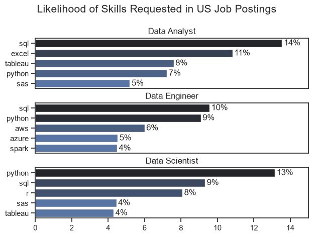
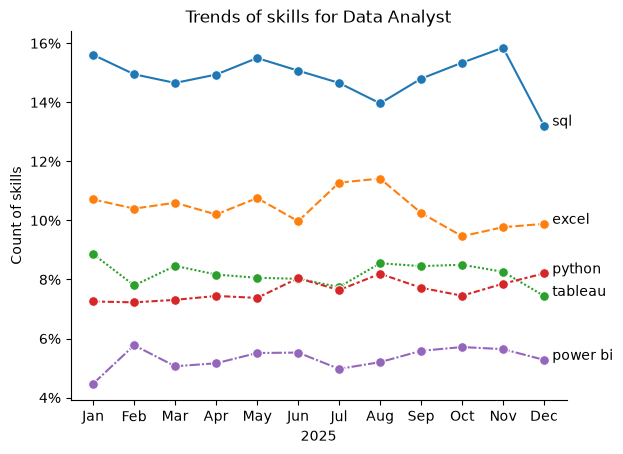
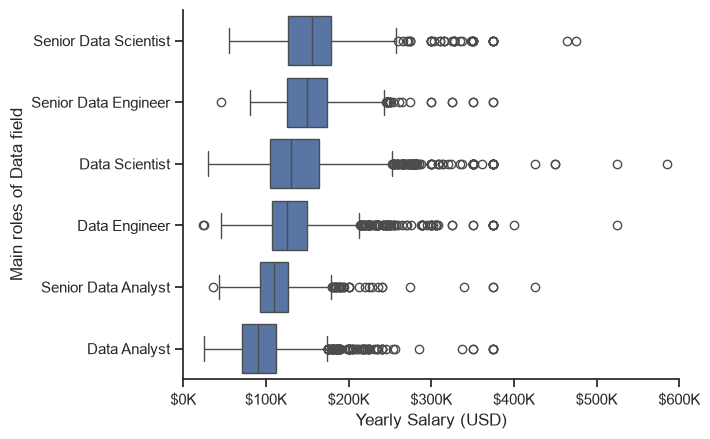
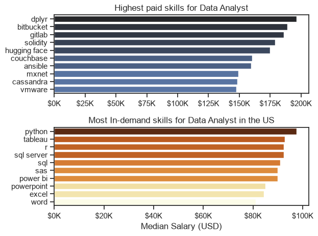
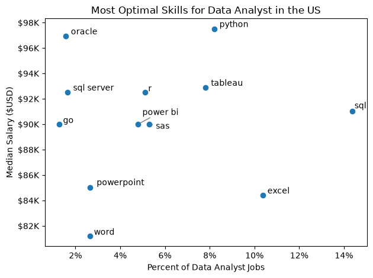
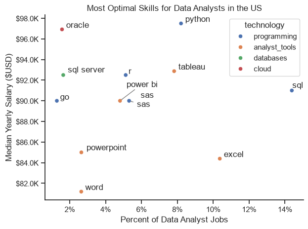

# Overview
Welcome to my analysis of the data job market, focusing on data roles. This will help us to understand and explore more about data job recruitment market. So, we can make good decisions through visualizing data.

The data sourced from Luke Barousse's Python Course which provides a foudation for my analysis. This project demonstrate my ability on using Python to explore key questions such as  the most demanded skills, salary trends, and the intersection of demand and the salary in data analytics.
# The Questions
1. What are the skills most in demand for the top 3 most popular data roles?
2. How are in-demand skills trending for Data Analysts?
3. How well do jobs and skills pay for Data Analysts?
4. What are the optimal skills for Data Analysts to learn?(Effective in both Demand and Paying)

# Tools I used
- Python: the main tool I Exploratory Data Analytic to analyze data and find critical insight. Also, i use the following Library:  
     - Pandas library: This was used to extract, clean and analyze data.
     - Matplotlib Library: I use it to visualize data into chart.
     - Seaborn Library: It will reinforce charts to become advanced and easy to follow.
- Jupyter Notebook: The tools that i can easily note and code in every cell effectively.
- Visual Studio Code: The workspace allow me to manage records and excute code in local repository.
- Git & GitHub: Essential for version control and sharing my project to others.  

# Data Preparation and Cleanup

This section ensure executing code will be accurated and more usable.

## Import & Clean Up Data

I start by load the data set of this project and modify data column into right type itself.

```python 
import pandas as pd   
import matplotlib.pyplot as plt   
from datasets import load_dataset
import seaborn as sns
import ast
# Loading data
dataset = load_dataset('lukebarousse/data_jobs')
df = dataset['train'].to_pandas()
# Data cleanup
df['job_posted_date'] = pd.to_datetime(df['job_posted_date'])  
df['job_skills'] = df['job_skills'].apply(lambda x: ast.literal_eval(x) if pd.notna(x) else x)    
```
## Filter US Jobs
To focus on US job market, I filtered out job postings only on United States.

```python
df_US = df[df['job_country'] == 'United States']
```

# The Analysis

Each single questions will dive into every aspects of job market.

## 1. What are the most demanded skills for the top 3 most popular data roles?
To filter out the most demand skills for 3 main role which is Data Analyst, Data Engineer and Data Scientist, I initially used groupby to group all job_title_short with aggregate function which is size of every skills in each role. The below plot step using seaborn is final parts to help them become more visualized and show popular data roles and their most demanded skills.

Click here to view step by step of this section: [1_Skill_Demand](1_Skill_Demand.ipynb)

### Visualize Data

```python  

job_list = ['Data Analyst', 'Data Engineer', 'Data Scientist']
fig, ax = plt.subplots(3, 1)


for i, job in enumerate(job_list):
    df_plot = df_percent[df_percent['job_title_short'] == job].head(5)

    sns.barplot(data = df_plot, x = 'skill_percent', y = 'job_skills', ax = ax[i], hue = 'skill_percent', palette = 'dark:b_r')
   
plt.show()

```
### Result


*Bar graph showing the percentage of requested skill in job postings in 3 main role in Data team.*
### Insights:
- SQL is the most popular skill in 3 main data roles with over 9%. This is still an important skill that learner need to follow before apply for data jobs.
- Python and analytic tools is following skills which is properly for Data Analyst to find out insights based on data
-cloud Platforms like aws, azure and big data tools like kafka is the best choice for Data Engineer.
-Data Scientist is focusing more on algorithm programming and using code platform like python, sql, r or sas.

# 2. How are in-demand skills trending for Data Analyst?
Before using pivot table to pivot count of skill in every month, I'am going to modify job_title to 'Data Analyst' and this role must be in United States. Then, I tranform job_posted_date column into format month number to easily pivot them into a new dataframe and select the most demand skills and view their trends. This visualization here is going to show trending of every single skills for Data Analyst in 2025 period.

Click here to view step by step of this section: [2_Skills_Trend](2_Skills_Trend.ipynb)

## Visualize Data

```python
from matplotlib.ticker import PercentFormatter

sns.lineplot(data = df_percent, linestyle = '--', marker = 'o', markersize=7, palette = 'tab10')
sns.despine()

ax = plt.gca()
ax.yaxis.set_major_formatter(PercentFormatter(decimals=0))

for i in range(5):
    plt.text(11.2, df_percent.iloc[-1, i], df_percent.columns[i])

plt.show()
```
## Result

*Line graph visualizing the trending of top skills for Data Analyst in the US throughout 2025.*
## Insights:
- SQL remains first top through 12 months of 2025 by around 14% -16%.
- Three follow analytic skills were excel, python and tableau. Excel show more dominant with stable fluctuation by around 10% than 2 remaining skills which is python and tableau, these both skills were seemed to be same priority with around 8%.
- Power bi was the lowest rank with under 6% throughout whole 2025.

# 3. How well do jobs and skills pay for Data Analyst?
Before jumping into analyzing salary of in-demand skills for Data Analyst, I'm going to groupby main roles of data field. This will show the salary distributions of main roles which is Data Analyst, Data Engineer and Data Scientist, also their Senior position as well.

Click here to view step by step of this section: [3_Salary_Analysis](3_Salary_Analysis.ipynb)

## Distribution of Salary for Main Data Role

### Visualize Data

```python
sns.boxplot(data = df_role_main, x = 'salary_year_avg', y = 'job_title_short', order = job_order)
sns.despine()
plt.xlim(0, 600000)

ax = plt.gca()
ax.xaxis.set_major_formatter(plt.FuncFormatter(lambda x, _: f'{int(x/1000)}K'))

plt.show()
```
### Result

*Box plot visualizing comparision of median yearly salary in specific main roles of Data.*
### Insights
- Senior position of Data Scientist and Data Engineer were prioritizing more in job postings with median salary nearly 200K dollar per year.
- Data Analyst and Senior Data Analyst were seemed to be the lowest rank with over 100K dollar per year.

## Highest Paid & Most Demanded Skills For Data Analyst
Next, i'm going to narrow to specific skills for Data Analyst role and compare number of job postings about every skill with median salary of those each skill. From that, we can point out which skills are potential with both demand and paying.

### Visualize Data

```python
fig, ax = plt.subplots(2,1)

sns.barplot(data=df_top_pay, x = 'median', y = 'job_skills', ax = ax[0],hue = 'median', palette='dark:b_r')
ax[0].xaxis.set_major_formatter(plt.FuncFormatter(lambda x, _: f'{int(x/1000)}K'))

sns.barplot(data=df_count, x = 'median', y = 'job_skills', ax = ax[1], hue = 'median', palette = 'YlOrBr')
ax[1].xaxis.set_major_formatter(plt.FuncFormatter(lambda x, _: f'{int(x/1000)}K'))

plt.show()
```
### Result

*Bar graph show the distribution of top paying skills also salaries of top demand skills for Data Analyst.*

### Insight
- The top graph show limited demand skills for Data Analyst but they've been prioritized to pay competitive salary. The dplyrm bitbucket and gitlab nearly reached up to 200K dollar. This skill will help business to solve complicated problems and approciated highly in job descriptions.
- The bottom graph demonstrated fundamental skills like python, sql, power bi or excel are necessary for Data Analyst, even though they may not offer the highest salary.
- There is a clear conclusion between 2 graph above. Data Analyst should aim to follow to divered skill to seize nowaday's trending and enhance their values, also not skip over fundamental skills to satisfy job description.

# 4.What are the most optimal skills to learn for Data Analysts?
There will be two part of this question. First, I'm going to find out what the most optimal skills for Data analyst. Also, optionally we're going to explore more about these optimal skills relating to what technology.

Click here to view step by step of this section: [4_Optimal_Skills](4_Optimal_Skills.ipynb)

## Optimal Skills for Data Analyst based on Salary and Count

### Visualize

```python
from adjustText import adjust_text
from matplotlib.ticker import PercentFormatter

plt.scatter(df_DA_skill['skill_percent'], df_DA_skill['median_salary'])

#Prepare texts for adjusttext
texts  = []
for i, txt in enumerate(df_DA_skill.index):
    texts.append(plt.text(df_DA_skill['skill_percent'].iloc[i], df_DA_skill['median_salary'].iloc[i], ' ' + txt))

#Adjust text to avoid overlap
adjust_text(texts, arrowprops=dict(arrowstyle= '->', color = 'gray'))

#Adjust layout and display plot
plt.tight_layout()
plt.show()
```
### Result

*Graph showing what the most optimal skills to learn based on demand and salary*

### Insights
- The most competitive salary skills is Oracle with $98K despite of lowest demand in this group. The point showing that a outstanding skill but less people follow will attract recruiter.

- Fundamental kills have high demand like sql, excel will only have lower salary because many people can learn them. Meanwhile, Python and Tableau were the most optimal skills to learn with highest salary and demand over 8%.

- So, worker will not only firmly grasp the knowledge about fundamental skills but also need to pursue new skills to advance their competition.

## Technology of optimal skills
### Visualize 

```python
from adjustText import adjust_text
from matplotlib.ticker import PercentFormatter

sns.scatterplot(data = df_DA_skills_tech, x = 'skill_percent', y = 'median_salary', hue = 'technology')

# Prepare texts for adjustText
texts = []
for i, txt in enumerate(df_DA_skills_tech.index):
    texts.append(plt.text(df_DA_skills_tech['skill_percent'].iloc[i], df_DA_skills_tech['median_salary'].iloc[i], ' ' + txt))

# Adjust text to avoid overlap
adjust_text(texts, arrowprops = dict(arrowstyle= '->', color = 'gray'))

#Adjust layout and display
plt.tight_layout() 
plt.show()
```

### Result

*Graph showing what the most optimal skills and their technology*

### Insights
- Fundamental programming technologies like python and sql are highly required and also have a high level of salary.
- Analyst tools are not prioritized with lower salary but they have medium request
- Databases and cloud are the highest competition salary despite of lowest demand for Data Analyst. However, they play an important role in building data pipelines.